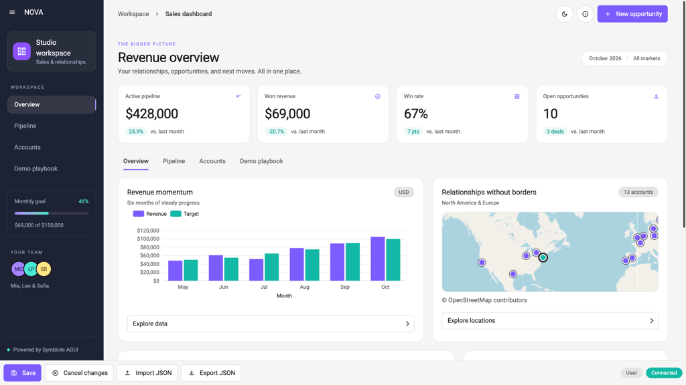

# Published with this interface

This document and its image are local session assets. They work without an external host.

<figure>
  
  <figcaption>Relative media resolves against this document's URL.</figcaption>
</figure>

Use `./_assets/` URLs in the interface. Rename and project transfers preserve those references. Publishing a public link also makes these files available to its visitors.
